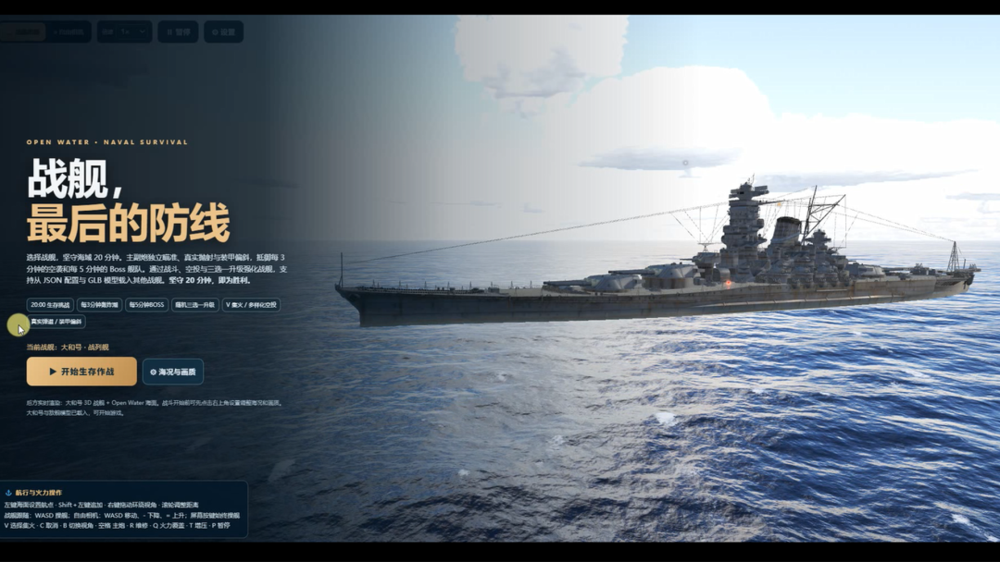

# 战舰，最后的防线 · Warship Survivors

<p align="center">
  
</p>

**OPEN WATER · NAVAL SURVIVAL** —— 一款运行在浏览器里的 3D 海战生存游戏。
你将指挥一艘战舰，在茫茫大洋上迎接 20 分钟的极限考验：抵御战略轰炸机波次，规避鱼雷与穿甲弹，扼守每 3 分钟逼近的驱逐舰与每 5 分钟一次的 Boss 旗舰。通过空中支援、升级强化技能、安排补给，在炮火与巨浪中把握胜利；每分钟 OSS 都会影响最终结果。

> 二十分钟 · 唯一战舰 · 最后一道防线

## 特性

- **真实海面**：基于 [Open Water](https://github.com/Leonxlnx/open-water) FFT 海浪引擎，支持海况/天气调节、水下视角、贴水白沫与航行尾流
- **硬核舰炮**：每座炮塔拥有独立指向、转速、射界与装填倒计时；支持第一人称炮瞄镜（Shift），逐炮射击或齐射
- **瞄准与核心区**：自动锁定 + 手动提前量，命中弹药库/核心区触发额外伤害倍率
- **舰队成长**：空中支援（战斗机/轰炸机）、Q/R/T/E 四技能、自动维修、升级强化
- **自定义舰船**：敌我舰艇均为 JSON 配置（model / stats / weapons / skills），可搭配独立 GLB/ZIP 模型导入，打造你自己的舰队
- **跨平台**：桌面端键鼠完整操控，手机/平板横屏触控（虚拟 WASD + 技能键）

## 快速开始

### 方式一：在线模式（需联网加载 Three.js 与 Open Water）

```bash
cd V29
python -m http.server 8000
# 浏览器打开 http://localhost:8000/
```

### 方式二：本地依赖（之后可完全离线）

```bash
python install_dependencies.py          # 首次联网时下载引擎到 vendor/
python serve.py --host 0.0.0.0 --port 8000
# 浏览器打开 http://localhost:8000/ （启动器会优先使用本地依赖）
```

`serve.py` 是内置的启动/部署脚本；服务器首次部署缺依赖时执行 `python serve.py --install`。

## 操作说明（PC）

| 按键 | 功能 |
| --- | --- |
| 左键点击海面 | 设置航点（Ctrl+左键 追加航点） |
| Shift | 进入 / 退出主炮瞄准镜 |
| 炮瞄内鼠标移动 | 调整瞄准与提前量；单击逐炮射击，双击齐射 |
| WASD | 航行 / 自由相机移动（Alt 加速） |
| Q / R / T / E | 技能 |
| V / C | 集火 / 取消集火 |
| B | 切换镜头 |
| P | 暂停 |

手机/平板请横屏使用：轻点海面设航点、拖动旋转镜头，左下角虚拟 WASD，右下角炮瞄与技能键。

## 自定义舰船

- 开始菜单 → 设置 → **战舰库**：导入我方战舰 JSON + GLB/ZIP 模型
- 开始菜单 → 设置 → **敌军舰艇库**：为巡逻艇/驱逐舰/巡洋舰/精英巡洋舰/战列舰/BOSS 分别导入配置
- 参考模板见 [`ships/`](ships/) 目录，敌我共享 `schemaVersion: 1`（含 model/stats/weapons/skills，敌方另有 enemy 扩展块）
- 模型弱点区可在 `ships/enemies/*.json` 的 `model.criticalZones` 中编辑

## 版本历程（节选）

| 版本 | 主要更新 |
| --- | --- |
| V19 | 手动主炮瞄准镜、键位重排 |
| V20–V21 | 指针锁定炮瞄、核心区命中与瞄准优化 |
| V22 | 自动锁定、手机横屏支持、去 jsDelivr 本地依赖方案 |
| V23 | 战斗反馈与血条 |
| V24–V26.1 | 服务器部署脚本、海水调优、水下渲染、404 修复 |
| V27–V29 | 完整非模型包安装、舰海融合、水下伪层与浪花失真修复 |

各版本详细说明见根目录对应的 `V*_更新说明` 文档。

## 技术栈

- 前端：原生 JavaScript + Three.js（GLB 模型）+ [Open Water](https://github.com/Leonxlnx/open-water)（FFT 海洋）
- 部署：纯静态文件，`serve.py` / `python -m http.server` 即可托管，无需构建
- 数据：舰船/武器/技能全部 JSON 驱动，模型与资源分离存放

## 许可与说明

- 游戏代码与文档仅供学习交流使用
- Three.js 与 Open Water 遵循各自上游许可证
- `assets/` 中的 GLB/ZIP 模型资源请勿用于商业用途
